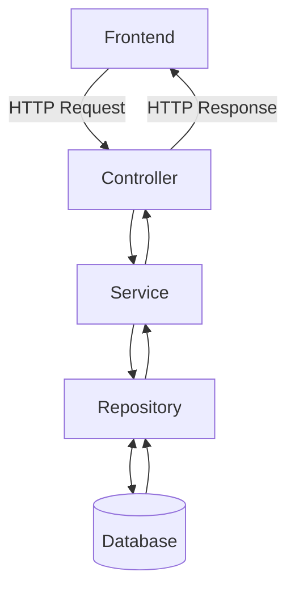

# Spring Boot Authentication API — Quick Revision

## 1. What have I done till now?

- Created REST API endpoints for registration and login.
- Used BCrypt to hash passwords.
- Added input validation to reject invalid input.
- Learned `Optional<User>`, `JpaRepository`, Constructor Dependency Injection, `@Configuration`, and `@Bean`.

## 2. REST API flow

The frontend sends a request. The backend processes it and returns a response.



- **Controller:** receives the request.
- **Service:** contains the main logic.
- **Repository:** communicates with the database.
- **Database:** stores or retrieves data.

## 3. Register and login

### Register
1. Receive username and password.
2. Validate the input.
3. Check whether the username already exists.
4. Hash the password using `passwordEncoder.encode(...)`.
5. Save the user with the **hash**, not the raw password.

### Login
1. Receive username and password.
2. Find the user using the repository.
3. Handle the case where the user does not exist.
4. Verify the password using `passwordEncoder.matches(rawPassword, storedHash)`.
5. If it matches, continue the configured authentication flow.

**Why POST for login?** GET can put credentials in the URL, where they may appear in browser history or logs. POST sends them in the request body. HTTPS is still required; POST alone does not secure credentials.

## 4. BCrypt password encoder

```java
passwordEncoder.encode(rawPassword);           // Create a password hash
passwordEncoder.matches(rawPassword, storedHash); // Verify a password
```

- `encode()` creates a BCrypt hash to store in the database.
- `matches()` checks the entered password against the stored hash.
- BCrypt hashes can look different for the same password because a salt is used.
- The method is called `matches()`, not `match()`.

`PasswordEncoder` is the interface; `BCryptPasswordEncoder` is an implementation. `passwordEncoder` is just my variable name.

## 5. Input validation

Validation checks whether the incoming data follows the rules, such as a username not being blank or a password meeting the configured requirements.

Spring validation commonly uses annotations such as `@NotBlank`, `@Size`, and `@Valid`.

Validation does not replace authentication, authorization, or database constraints.

## 6. `Optional<User>` and `JpaRepository`

```java
Optional<User> findByUsername(String username);
```

- `T` is a placeholder for a type; here, `T` is `User`.
- The user might exist or might not exist in the database.
- `Optional<User>` represents both possibilities so I can handle a missing user clearly.
- `JpaRepository` provides common database operations.

**Remember:** `Optional` does not prevent every `NullPointerException`. An empty `Optional` still needs to be handled; calling `get()` on it throws an exception.

## 7. Constructor Dependency Injection

### Without DI

```java
class OrderProcessor {
    private final EmailService emailService = new SmtpEmailService();
}
```

`OrderProcessor` creates and depends directly on a specific implementation.

### With constructor DI

```java
class OrderProcessor {
    private final EmailService emailService;

    OrderProcessor(EmailService emailService) {
        this.emailService = emailService;
    }
}
```

```java
OrderProcessor op = new OrderProcessor(new SmtpEmailService());
```

In Spring Boot, Spring can provide the dependency if the required implementation is registered as a bean.

**Why use it?** The class does not create its own dependency. This makes the code more loosely coupled and easier to test or provide with another implementation.

**Memory level:** The constructor receives a reference to the service object and stores that reference in `this.emailService`. It does not copy the whole service object into `OrderProcessor`.

## 8. `@Configuration` and `@Bean`

```java
@Configuration
public class AppConfig {
    @Bean
    public PasswordEncoder passwordEncoder() {
        return new BCryptPasswordEncoder();
    }
}
```

- `@Configuration` marks a class that provides bean definitions.
- `@Bean` marks a method whose returned object Spring registers and manages as a bean.
- The method itself does not become an object; Spring manages the object returned by the method.
- Spring can inject that bean into a service through constructor DI.

## 9. Quick revision table

| Concept                          | Remember it as |
|----------------------------------|---|
| REST API                         | Communication between frontend and backend |
| Controller                       | Receives HTTP requests |
| Service                          | Contains business logic |
| Repository                       | Works with the database |
| `encode()`                       | Hashes the raw password |
| `matches()`                      | Verifies the entered password |
| `Optional<User>`                 | User result may be present or absent |
| Constructor Dependency Injection | Required dependency comes through the constructor |
| `@Configuration`                 | Defines Spring bean configuration |
| `@Bean`                          | Registers the returned object as a Spring bean |
| Validation                       | Rejects input that breaks defined rules |

## 10. What should I learn next?

1. DTOs and exception handling.
2. Tests for registration, login, and invalid inputs.
3. Database transactions.
4. Authentication vs. authorization.
5. Sessions or JWT, after understanding the basic login flow.
6. How these components fit together in system design.

**My current understanding:** I have learned the basic registration/login flow, password hashing, handling a possibly missing user, and how Spring injects dependencies. Next, I should test failure cases and understand the complete request flow before adding more features.
